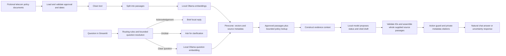

# Architecture

## Purpose

Answer telecommunications retail questions using approved fictional evidence. Example: "Can a secondary account contact replace a stolen SIM?" A supported answer may require SIM-replacement, identity and account-authority guidance. The assistant cannot verify identity or replace the SIM itself.

## Implemented flow



Document loading, metadata validation, approval/date selection and the library viewer are implemented for 12 fictional policies. The 11 eligible policies produce 33 section chunks, all embedded locally and stored in Pinecone. On 2026-10-18, local Ollama generation and a 15-case evaluation runner were added. Expected answers are used for review, never sent to the model. E11 deliberately uses only its authored SIM document subset; it is separate from ordinary retrieval measurement. See [evaluation](evaluation.md) and [local generation](local-generation.md).

The user has accepted the current natural chat interface, including the removal of evidence controls. `app.py` supplies the chat, while `library_app.py` preserves the original document viewer as a separate command. `conversation.py` resolves a follow-up before fresh retrieval; previous assistant answers do not become approved evidence. `pipeline.py` connects the existing retrieval, lookup, context and generation functions for one in-memory turn. The next focus is checking grounded knowledge answers through that same function. See [chat behavior](chat-design.md) and [current-chat evaluation](chat-evaluation.md). User acceptance and automated checks do not independently verify browser rendering or accessibility.

```text
IMPLEMENTED: policies -> eligible sections -> local embeddings -> Pinecone storage
IMPLEMENTED: terminal question -> query embedding -> search -> passages and source details
OPTIONAL:    explicit policy IDs/references -> one bounded fetch -> additional labelled passages
IMPLEMENTED: saved retrieval -> local validation and deduplication -> labelled context preview
IMPLEMENTED: context + answering rules -> prepared messages (offline)
IMPLEMENTED: compact evidence -> local model draft -> source-ID checks -> whole source passages
IMPLEMENTED: explicit-action guard -> guidance-only status -> private metadata citations
REVIEW:      compare actual claims with cited passages; evaluate completeness separately
IMPLEMENTED: 15-case runner, saved evidence/answers and separate semantic-review records
IMPLEMENTED: bounded user-question resolution -> fresh retrieval -> natural Streamlit chat
PRIVATE:     per-turn evidence, source metadata, resolution and reported usage in session memory
SEPARATE:    library_app.py and existing terminal reports for learning/inspection outside chat
```

## Conversation and interface boundary

The chat accepts a question or starter submission. A contextless reference such as "Can I replace it?" receives a clarification before embedding, Pinecone or generation. Clear standalone requests use deterministic routing. An explicit noun reply such as "A physical SIM" can fill the pending reference while preserving replacement intent. Some other follow-ups use the existing local model to propose a standalone question; strict output-shape, vocabulary and topic checks can reject it and ask for clarification. These narrow English rules can still misinterpret or over-clarify; prior quality gaps motivate the current comparison rather than being declared solved by code changes alone.

`[conversation]` currently permits three recent user turns, 1,000 characters per question and 4,000 combined history characters. History retains complete turns only; previous assistant text and retrieved evidence never enter the resolver's reference context. The app selects the last three raw turns first, skips acknowledgements within that window and treats any failed turn as a boundary. Skipping does not extend the window or cross a failed turn. It retains at most 30 displayed exchanges in the current Streamlit session, with no ordinary on-disk chat logs or cross-session conversation storage. New chat clears conversation and private turn records. Complete acknowledgements such as "OK thanks" receive a local reply before corpus/credential loading or service calls.

Each clear or resolved question receives fresh eligible evidence from Pinecone, including bounded reference lookup when applicable. The active `prompts/answering-grounded-v2.md` sees compact evidence with whole text and source labels. With `[answering].presentation = "source_passages"`, `source_guidance.py` uses validated draft source IDs to display complete selected passages, other supplied sections from those documents and supplied passages directly referenced in the original selection. It never expands beyond the pack or recursively follows added passages. The model's policy prose is retained privately but is not displayed.

This assembly preserves exact canonical wording; it does not prove relevance or completeness. Extra paragraphs, unselected essential evidence and incorrect uncertainty statuses remain possible. The app retains original/final drafts, selected/added IDs, missing references and metadata citations privately. Plan-name aliases apply only to display text. Whole-passage bounds remain enforced; display validation allows the configured context source count rather than silently cutting the result to the model's six-claim limit.

If an insufficient-evidence draft selects nothing, a narrow request for one named policy's contents can seed assembly with exact policy-ID matches already in the pack. General policy mentions and unrelated questions do not activate this fallback. Guidance accompanied by an insufficient status gets neutral introductory wording; missing referenced-policy passages get a specific evidence-gap message. The model's original status is retained rather than relabelled as a verified classification.

The application independently assigns `action_not_supported` for recognised requests to execute a transaction, including mixed action/guidance questions. The guard uses explicit English request patterns and named objects; it does not supply missing policy evidence, confer authority or classify every possible phrasing. Plain answer text or clarification/uncertainty remains in the approved interface without source buttons, expanders, diagnostics or a library toggle. Native text prevents user/model Markdown or HTML from embedding images.

Only submission enters the service pipeline. Reruns and New chat reuse or clear local state and make no service calls. Pipeline errors become deliberately authored messages, with no raw provider exception or earlier answer presented as the failed request's result. No automatic retries are configured. The earlier chat-implementation suite passed 281 tests, including 12 AppTest UI checks, 17 pipeline checks and 18 conversation checks with simulated responses at that milestone. A real network-blocked pipeline check clarified "Can I replace it?" without retrieval. The Streamlit page and health endpoint returned HTTP 200. Real appointment and follow-up requests returned supported answers with one private citation each in 94.1 and 137.5 seconds. The follow-up resolved "one" to an appointment for a physical SIM replacement. These are two checked examples, not general model-quality or latency results. Browser rendering remains unverified; AppTest does not render a browser.

## Evaluating the current chat route

The current implementation passed **394 offline tests in 12.824 seconds**. The Python launcher started a real server on 8502 with HTTP 200 and that test instance was stopped; the owned 8501 server also returned HTTP 200. Final review combines initial requests, separate reruns and service-free presentation replays, rather than a single fresh final-version 14-case batch; the six-turn real AppTest rehearsal is pending. Browser rendering remains unverified. Windows standby events occurred during long test gaps; interrupted timings must not be presented as normal inference latency. See [demo readiness](demo-readiness.md) and [operating instructions](demo-guide.md).

`runtime_power.py` now scopes a Windows `ES_SYSTEM_REQUIRED | ES_CONTINUOUS` request around local Ollama HTTP opening and response reading. A `finally` block restores the previous calling-thread state on success or failure; unsupported platforms/API failures do not replace the request result. It requests no display/away mode and changes no persistent power plan. Deliberate sleep and lid closure remain respected. The earlier temporary helper was stopped before final E05 verification. This is operating protection, not evidence of answer quality. [Microsoft API documentation, checked 2026-10-19](https://learn.microsoft.com/en-us/windows/win32/api/winbase/nf-winbase-setthreadexecutionstate).

`evaluate_chat.py` calls the same `run_chat_turn` function as Streamlit, using fresh isolated histories for E01, E05, E07, E08 and E09. Clear questions perform fresh retrieval rather than reusing historical evidence. The default preview has no service calls or output writes; explicit `--run` saves separate artifacts in `data/processed/chat-evaluation-2026-10-18`. Nonempty destinations are refused, preserving the older 15-case baseline and every completed new run.

The run records actual answers, supplied evidence, source metadata and reported usage. Authored reference answers and expected sections remain outside the pipeline, in a separate review field. A semantic review then checks claim support, conditions, completeness and response behavior separately from retrieval coverage. Codex reviews are labelled as such. These isolated questions do not test follow-up memory or browser behavior; see [the scenario lesson and measured results](chat-evaluation.md).

The first five requests completed on 2026-10-18; separate Codex review found three meeting the established minimums. E05 received all expected evidence but omitted identity conditions and overstated a restriction. E09 was incorrectly routed to clarification before retrieval. E08's safe generic fallback met its minimum while leaving room for a more specific referral. All expected sections were found in the three cases that searched; this conditional result does not mean every scenario took the right route. The runner's 12 focused tests and the full 322-test suite passed. No runtime or prompt correction was made during this baseline.

## What happened after connecting to Pinecone

1. Read the API key privately from Week2's `.env` and successfully authenticated. The project initially had no indexes. Authentication confirms access; it does not establish the billing plan or remaining allowance.
2. Installed the official Pinecone Python SDK, version 10.0.0. This library sends our Python requests to Pinecone; it is separate from the LangChain document container.
3. Rebuilt eligible chunks from source files and compared the saved embeddings with their current text, metadata, model digest and configured date. All 33 records from 11 policies matched. The archived SIM version stayed excluded.
4. Created `retail-copilot-week2` in AWS `us-east-1`, with a 768-dimensional `embedding` field and cosine similarity. Dimensions match the local model; cosine will compare vector directions during search.
5. Uploaded the records into `telecom-demo-v1`, a namespace representing this fictional corpus. Each has `_id`, `embedding`, `text` and source metadata fields. Pinecone stores our supplied vectors; it did not generate them.
6. Confirmed the namespace contained 33 records and fetched every expected ID. Compared exact text/source metadata and vector values with numeric tolerance. All matched; the fetch reported 4 read units.
7. Saved the index host in the private `.env` and a dated verification report in ignored `data/processed/`. No key was displayed or committed.

`pinecone_ingest.py` implements this path. Its default mode only previews local checks; `--upload` performs cloud operations. Matching existing records are verified without another application-level write; a different corpus or model stops for review. There is no automatic synchronization/deletion of old policy versions.

The full suite passed 127 tests, including 13 simulated ingestion checks. The real upload/read-back is separate evidence. This confirms storage, not whether search finds the right evidence. Pinecone will return candidate passages; a language model will later draft the answer.

## Components in plain language

The retrieval command rebuilds eligible local evidence, checks the saved corpus and remote index identity, then creates a query embedding with the model-specific prompt. It calls `index.documents.search` with one dense-vector clause and explicit text/source fields. Returned records must match eligible local text and metadata. Valid results use LangChain Document containers with separate scores.

The baseline uses `top_k = 4` without remote metadata filters, rewriting, reranking or keyword search. Expected-source recall is 1/1 for E01, 2/3 for E04 and 1/2 for E06. The latter searches miss training-ID and appointment evidence. All 144 automated tests passed; three live searches reported 3 total read units. Candidates are not automatically sufficient evidence. Policy eligibility stays fixed at 2026-10-15.

The subsequent optional `--follow-references` enhancement uses explicit question IDs first, otherwise references in original semantic passages. `policy_lookup.py` resolves approved section IDs locally, fetches their text/source fields from Pinecone once, and validates them. Limits are two policies and six added sections; duplicates and recursive expansion are prevented. Fetched passages carry lookup provenance and no similarity score. The same cases improved to 1/1, 3/3 and 2/2 expected sections with 8, 8 and 5 total passages. This run reported 6 read units. All 158 automated tests passed after the change. Default semantic search remains unchanged; broader relevance and evidence sufficiency are unmeasured. See [policy lookup](policy-lookup.md).

| Component | Input | Output | Main risk |
| --- | --- | --- | --- |
| Document validation (implemented) | Fictional text and metadata | Approved policies valid for the selected date | Bad metadata can admit outdated guidance |
| Chunking (local comparison and preparation implemented) | Validated sections, after eligibility selection | Comparison passages or a saved JSON snapshot with text, stable IDs and source metadata | Splitting a rule from its exception, missing related policies or keeping an oversized section |
| Embedding preparation (local report implemented) | Exact eligible chunk text, model settings and dated price | Per-input token checks and an estimated corpus embedding cost | Measuring different text from the later request, or treating an estimate as an actual bill |
| Embedding (all 33 local vectors verified) | Eligible chunks plus the model's document prompt/title | 768-number vectors linked to original text, metadata, exact input and reported usage | Losing conditions through truncation, mixing models or confusing structural checks with retrieval quality |
| Pinecone record mapping (locally tested) | Validated embedding result | `id`, `values` and flat metadata including original text | Wrong source links, unsupported metadata or oversized records |
| Pinecone ingestion (real upload verified) | Current validated corpus and private credential | 33 stored records with `_id`, named `embedding`, text and source fields | Wrong destination/model, stale sources, incomplete writes or repeated usage |
| Pinecone retrieval (terminal baseline implemented) | Local question vector and configured namespace/top k | Ranked passages and metadata checked against eligible local sources | Missing essential evidence; similarity is not confidence |
| Policy lookup (optional, measured on three cases) | Explicit question policy IDs, otherwise references in original hits | Missing approved sections fetched once with source/provenance and no score | Extra text, unknown references, skipped dependencies and additional read usage |
| Context construction (offline preview implemented) | Saved retrieval and current local validated corpus | Whole passages, per-pack source labels, registry and size/reference notices | Extra irrelevant text, missing conditions, confusing labels or size checks with evidence sufficiency |
| Answering preparation (offline implemented) | Revalidated context and instructions file | Separate system/evidence messages and draft response format | Instructions alone cannot guarantee model behavior |
| Generation (local command implemented) | Instructions and revalidated saved evidence | Structured local Ollama draft and reported usage | Unsupported claims, latency, incomplete output or instructions hidden in source text |
| Draft checks and citation rendering (implemented) | Structured draft and the same revalidated context registry | Checked source IDs and source labels assembled from metadata | Valid labels do not establish relevant or complete guidance |
| Source-passage assembly (active) | Valid selected IDs and whole passages in the same pack | Exact selected/same-document/direct-reference paragraphs with private trace | Wrong selection, missing evidence, extra paragraphs and status uncertainty remain possible |
| Conversation resolution (implemented, offline checked) | New question plus bounded recent user questions | Unchanged/standalone retrieval question or clarification | Missed ambiguity, unnecessary clarification or a changed meaning; accepted output still needs real evaluation |
| Chat pipeline (implemented, offline checked) | Clear question, settings and private credential | Fresh evidence, validated draft, natural text and private source/usage records | Existing answer-quality gaps, provider failures, latency and recurring read usage |
| Streamlit chat (implemented, AppTest checked) | Submitted question or starter plus session state | Plain conversation with New chat; no evidence controls | Repeated service calls on rerun, stale context, unsafe text rendering and unverified browser appearance |

Grounding means basing claims on the supplied evidence. It requires evaluation; a prompt alone does not guarantee it. Source text must be treated as evidence, never as instructions to the application.

`answering.py` reads the configured instructions, currently `prompts/answering-grounded-v2.md`, revalidates the saved context and keeps evidence in a separate message. The proposed draft contains a status, claims with source IDs and an optional clarifying question. Code checks response format/limits and IDs; the chat then applies source-passage assembly and the action guard before rendering actual metadata citations privately. An unknown ID rejects the whole draft. Empty context selects a fixed insufficient-evidence fallback without preparing a model request. Relevant, complete guidance and correct uncertainty still require semantic evaluation. At the original preparation milestone, all 195 tests passed and the E04 prompt preview/manual source demonstration made no service calls. See [answering instructions](answering-instructions.md).

`context.py` prepares that evidence locally. It retains all validated unique candidates in original order, with no score threshold or new ranking. Duplicate IDs must agree; archived/changed records stop preparation. Configured limits are ten sources and 12,000 formatted characters, with no silent cutting or dropping. LangChain Documents supply text/source data; a JSON evidence string keeps the question and sources separate. A registry maps S1-style labels to actual metadata and retains search/lookup provenance outside model-facing evidence. These labels are local to each pack; `answering.py` checks draft IDs against that same revalidated registry. Semantic claim support is reviewed separately in the saved evaluations.

The E04 preview has eight complete sections and 5,266 characters; all 177 tests passed. Three saved cases preserved their original IDs/text without external requests. E06 flags referenced IDV/ESIM policies with no included passage. Reference presence is only a notice, not a sufficiency assessment; nonempty packs explicitly remain unassessed. Character limits do not establish a model token budget. See [context construction](context-construction.md). No generation model or remote retrieval behavior changed in this step.

## Source lifecycle

Keep document ID, policy ID, title, version, section and actual source filename with every future passage. The loader now also preserves category, segment, product, process, owner, review date and disclaimer. Only approved, currently effective evidence is eligible. Effective end dates are inclusive. Archived documents remain excluded even when viewing a historic date; historical-policy answering is outside this milestone. An overdue review prompts a reminder rather than automatic expiry.

Loaded policies and chunks now use LangChain's `Document` class from `langchain-core` (locked at 1.6.10). This supplies a standard container, while our own functions retain validation, eligibility and splitting rules. Each policy has its joined section text in `page_content`, its document ID in `id`, and source details plus local section structure in `metadata`. Dates are readable YYYY-MM-DD strings, converted to dates for comparisons. The container itself does not enforce our policy rules. [Official Document reference](https://reference.langchain.com/python/langchain-core/documents/base/Document).

The local comparison command applies eligibility before chunking. Each resulting `Document` holds passage text in `page_content` and an independent copy of source metadata plus section heading/ID and inclusive word positions. Chunks omit the parent policy's full `sections` collection. Both fixed-size variants restart within each section; the whole-section variant has no size cap yet. These containers are not ready-made Pinecone payloads. The provisional baseline is one chunk per existing section for this short corpus; model limits and retrieval quality still need validation.

The preparation command implements this local path:

```text
Local JSON policies -> validate -> LangChain policy Documents
                    -> approval/date selection -> section_chunks
                    -> LangChain chunk Documents with IDs and metadata
                    -> data/processed/chunks.json
```

Each saved record contains `chunk_id`, unchanged loaded section `text`, `word_count` and descriptive `metadata`. Saving maps the container's `id` to `chunk_id` and `page_content` to `text`, omitting comparison-only word positions from exported metadata. The JSON format and content remain the same as before the container migration. `SIM-1024-v2:checks:section-v1` identifies a policy version, section and method. IDs identify passages, not a cryptographic fingerprint of their contents; editing text under the same identifiers keeps its ID. Proper policy revisions should receive a new version. Any later vector update must account for content changes and removal of old records.

Preparation sorts records by ID and replaces the entire generated snapshot after a complete temporary-file write. Identical inputs/settings produce identical output bytes. Removed sections disappear on a successful rebuild; a failed rebuild leaves any earlier output, which must not be mistaken for current evidence. Empty eligible sets and overlapping approved versions stop preparation. The file records the chosen eligibility date and excluded document IDs; it is a dated local snapshot, not a live approval check.

This chunk JSON is not a Pinecone upload payload: it has no vectors and keeps a nullable end date. Embedding and upload preparation add vectors, validate metadata, omit optional nulls and serialize current SDK fields. Ollama rejects oversized inputs without truncation. Retrieval now filters eligibility and validates records against current local sources; automated cloud update/deletion handling remains future work. Keeping a section whole also does not automatically retrieve the other policies it references.

Overlapping approved versions of one policy stop processing. This catches version conflicts, not all semantic contradictions across different policies; those require later evaluation and review. The current synthetic flag checks a declaration, not the truth of the document's origin.

## Active local embedding baseline

The user selected Ollama on 2026-10-15 because no OpenAI key is available. `[embedding]` selects `embeddinggemma:300m`, 768 dimensions, a 2,048-token input limit and a loopback endpoint. All 33 sections have real saved vectors, totaling 1,808 reported input tokens. Exact matching cached inputs are reused. Titles and the model-specific document prompt are included in embedding input; original passages stay unchanged. Question embeddings must use the same model and the configured retrieval-query prompt. [Corpus lesson](corpus-embeddings.md).

`pinecone_records.py` prepares `id`, `values` and flat metadata with exact text, removes optional nulls and validates local format constraints. It makes no API request. `pinecone_ingest.py` rechecks eligibility and compatibility, then converts that mapping to the current SDK's `_id`, named `embedding` and accompanying source fields. [Storage mapping](pinecone-records.md).

## Embedding baseline selected, not yet run

This section records the earlier **OpenAI comparison baseline**, retained under `[openai_embedding]`. Its tokenizer and cost estimates do not apply to the active Ollama model. No real OpenAI embedding has run.

On 2026-10-15 we selected `text-embedding-3-small` as the initial embedding model. Its job is to turn passage text into a vector: a list of numbers used to compare related text. It does not write the final answer. Its lower public input-token price makes it a reasonable first baseline for this small English corpus; that is a project decision, not a measured quality result. [Model description and price](https://developers.openai.com/api/docs/models/text-embedding-3-small)

The settings record the default 1,536 output dimensions, meaning 1,536 numbers per vector, and the `cl100k_base` tokenizer encoding. The API documents a maximum of 8,192 tokens per input. The local token report now checks each chunk against that configured limit; it is not an instruction to enlarge chunks to that size. [Embedding guide](https://developers.openai.com/api/docs/guides/embeddings), [input limits](https://developers.openai.com/api/reference/resources/embeddings/methods/create)

```text
33 freshly prepared LangChain chunks -> local token report (implemented)
                                    -> embedding API (later, requires account access)
                                    -> vectors linked to chunk IDs/text/metadata
                                    -> Pinecone storage (later)
```

Selection initially changed configuration and documentation only. The next local step has now installed `tiktoken` and added `token_report.py`. It reuses the loader, approval/date selection and section chunker, counts exact `page_content` with no metadata or added headings, and does not change source documents or exports. On 2026-10-15, the 33 chunks totalled 1,404 tokens, with per-input sizes of 26–57. All passed the configured limit. The report flags oversized input and exits unsuccessfully without truncating it. See [the implementation and measured estimate](embedding-preparation.md).

Token counting downloads a public vocabulary on first use and then runs from cache; policy text remains local. That step made no embedding calls. A subsequent one-chunk integration now uses the official OpenAI SDK, with locally simulated tests; live calls and real vectors remain unverified.

## One-chunk request integration

`embed_example.py` selects the configured eligible section and previews its exact input and estimate. `embeddings.py` sends one input only when service use is explicitly enabled and its estimate fits the supplied allowance. The CLI reads a private key only after these checks, uses the configured endpoint and timeout, and disables automatic retries. Its default preview reads no credential or API client. The user has confirmed no API key and requested local testing, so service use stays disabled.

The response must match the model, single input index and vector dimensions, contain finite nonzero numeric content, and report valid usage. Successful live results would be saved with original text, independently copied metadata, model/dimension information and both estimated and reported-usage-based cost. Existing output stops a new live attempt before sending. This is a local example record, not a ready Pinecone payload. [Request walkthrough and verification](embedding-example.md).

The existing `paid_service_use_enabled` field gates OpenAI live mode. An explicit `--live` selection and positive `--max-cost-usd` allowance are also required. This checks an estimate for one attempt, not provider or cumulative billing. No real OpenAI vector or live OpenAI account access has been verified. Local Ollama runs are separate and require no paid-service flag.

## Operating boundaries

Use the same embedding model and vector dimension for documents and questions. The created Pinecone index uses 768 dimensions and cosine similarity. Re-embed and plan a compatible destination when the model changes, even if another model produces equal-length vectors. Handle unsupported evidence, ambiguous questions and action requests explicitly. The copilot cannot execute customer transactions.

Configuration lives in `config/`; credentials belong in local environment variables or Week2's ignored `.env`. Both embedding and answer inference use local Ollama. Pinecone stores vectors, original synthetic text and source metadata. OpenAI remains a disabled comparison option. Account setup, costs and an explicit spend limit must be addressed before any future paid use.

The user's latest direction keeps evidence, source metadata, relevance scores and measured usage outside the chat display. The pipeline retains those records privately in session memory; existing development commands/reports and the separate library viewer support inspection. It shows no confidence percentage or hidden internal reasoning. Ollama is the active embedding and generation provider. `retail-copilot-week2` and its `telecom-demo-v1` corpus namespace exist. The key and host are configured privately. The user reports Starter with Builder credits pending; remaining quota is not independently verified.

## Implemented local setup check

```text
Week2 .env + process environment variables
    -> credential-presence check
    -> present/missing report without values or network calls
```

`retail-check` supports setup independently of the RAG pipeline. It does not validate account access, enforce a spending limit or enable cloud calls. Environment variables take priority over this project's file; no parent `.env` is discovered. `library_app.py` remains a local document library independent of chat requests.

Missing account-authority evidence cannot establish either permission or a prohibition. The active instructions require an evidence-gap response without an authorisation decision, with a policy-owner or authorised-support referral when appropriate. Source copying does not prove the model chooses the right uncertainty status; the saved missing-authority scenario and current live comparison test that requirement.
